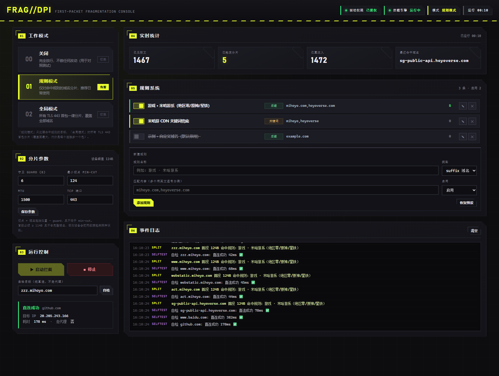
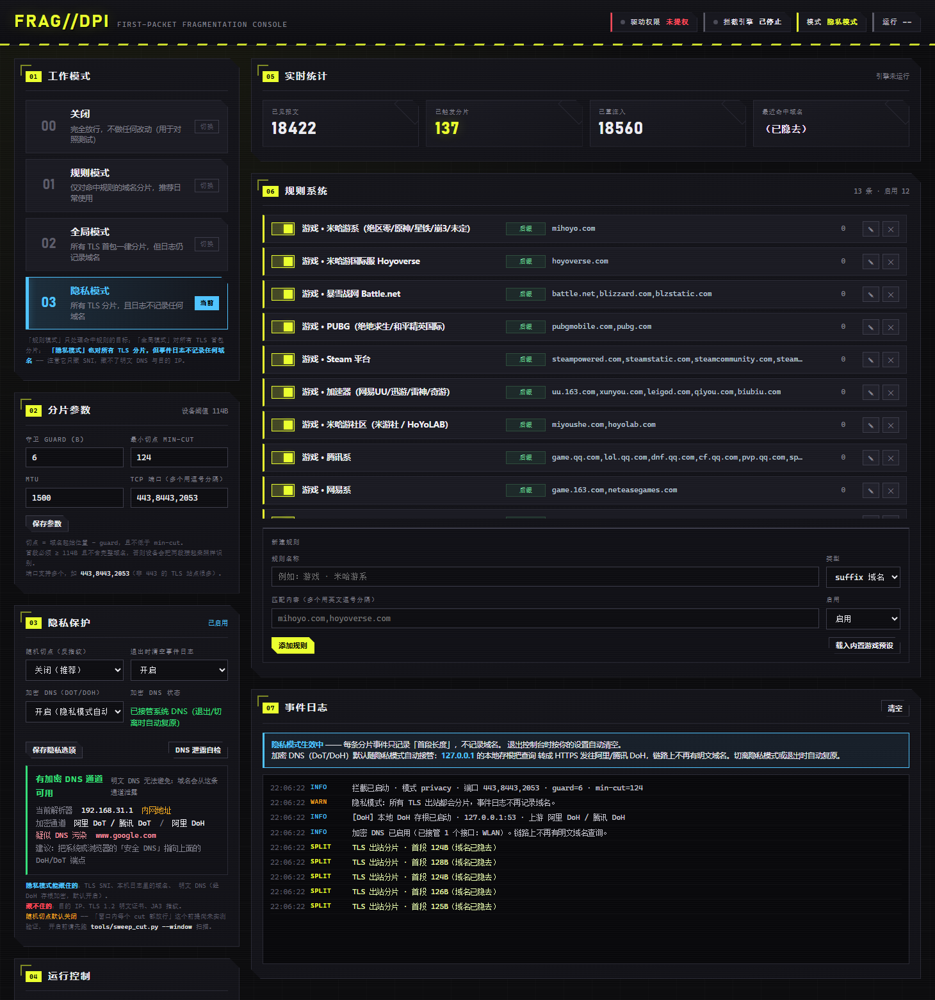

# FragDPI

> 一个基于 **WinDivert** 的 Windows 首包分片（TCP segmentation）工具，用来绕过
> 「只看第一个报文里的 TLS SNI 关键词」这种 DPI/上网行为管理设备。
> 带可视化 Web 控制台、规则系统、以及一整套可复现的实测研究脚本。
>
> A Windows **first-packet fragmentation** tool built on **WinDivert**, for working
> around middleboxes that block TLS connections by keyword-matching the **SNI in the
> first TCP segment**. Ships with a local web GUI, a domain rule engine, and the full
> set of reproducible measurement scripts used to reverse-engineer the device.

[](https://github.com/HeyanMCH/FragDPI/actions/workflows/tests.yml)
[](LICENSE)
[](#运行要求)
[](#运行要求)
[](#运行要求)

---

## English Abstract

FragDPI is a Windows-only, WinDivert-based packet re-segmentation tool. It hooks
outbound TCP connections, finds the `ClientHello` that carries the TLS SNI, and
splits the first segment into two (or more) TCP segments so that the full domain
keyword never appears inside the first packet — which is exactly what
keyword-matching middleboxes typically inspect.

Everything was reverse-engineered and validated against a real campus network
behavior-management device, and the whole measurement process is included in
[`research/`](research/):

* The device inspects **only the first TCP segment** and does **no stream reassembly**.
* It re-accumulates several leading segments up to a **114-byte threshold** —
  a first segment of **≤113 bytes gets blocked, ≥114 bytes passes**.
* Fragmentation therefore must (a) keep the first segment **≥114 bytes** and
  (b) land the cut **inside the SNI extension**, so the domain is never complete in
  the first segment.
* Blocking is **plain SNI keyword matching**, not IP- or vendor-based:
  `mihoyo.com` is blocked while `miyoushe.com` is not; `battle.net` is blocked while
  `blizzard.com` is not.
* **UDP is not filtered at all** — proven with a QUIC version-negotiation probe that
  needs no encryption handshake.
* Measured cost of fragmentation: **zero**. A/B tests on the same hosts show
  overlapping medians with and without fragmentation.

Of 103 probed domains, **36 were RST-blocked and 36/36 were successfully recovered**
by the engine, while allowed domains were unaffected.

**Requirements:** Windows x64, Python 3.8+ (standard library only), and
**Administrator privileges** (WinDivert loads a kernel driver).

**No proxy, no per-application setup** — browsers, game clients, and updaters all
benefit automatically because interception happens in the network stack.

---

## 目录

- [这个东西解决什么问题](#这个东西解决什么问题)
- [它是怎么做到的](#它是怎么做到的)
- [实测数据](#实测数据)
- [运行要求](#运行要求)
- [快速开始](#快速开始)
- [可视化控制台](#可视化控制台)
- [命令行工具](#命令行工具)
- [规则系统](#规则系统)
- [隐私保护模式](#隐私保护模式)
- [参数说明](#参数说明)
- [安全性说明：它会不会把系统搞挂？](#安全性说明它会不会把系统搞挂)
- [给遇到不同设备的人：怎么重新测自己的网络](#给遇到不同设备的人怎么重新测自己的网络)
- [目录结构](#目录结构)
- [局限与不适用场景](#局限与不适用场景)
- [常见问题](#常见问题)
- [免责声明与合法使用](#免责声明与合法使用)
- [许可证](#许可证)
- [致谢](#致谢)

---

## 这个东西解决什么问题

某些校园网 / 企业网会在出口放一台「上网行为管理」设备，靠 **TLS 握手里的 SNI 明文字段**
做域名黑名单。命中就双向注入 RST，浏览器表现是「连接被重置 / ERR_CONNECTION_RESET」，
游戏客户端则表现为登录卡住、更新失败。

本机所在网络的实测结论（2026-10）：

| 域名 | 判决 |
|---|---|
| `zzz.mihoyo.com`、`www.mihoyo.com`、`api-takumi.mihoyo.com` … | **被 RST** |
| `act.hoyoverse.com`、`sdk.hoyoverse.com` … | **被 RST** |
| `store.steampowered.com`、`api.steampowered.com`、`cdn.steamstatic.com` | **被 RST** |
| `battle.net`、`eu.battle.net`、`us.battle.net` | **被 RST** |
| `pubgmobile.com`、`uu.163.com` | **被 RST** |
| `miyoushe.com`、`hoyolab.com` | 放行 |
| `blizzard.com`、`blzstatic.com`、`pubg.com` | 放行 |
| 腾讯系（`lol.qq.com` / `dnf.qq.com` / `cf.qq.com` …） | 放行 |
| 网易系、库洛、鹰角、西山居、完美、巨人、盛趣 | 放行 |
| PlayStation / Xbox / Epic / Riot / Nintendo / Roblox / Mojang | 放行 |
| 各类加速器（迅游 / 雷神 / 奇游 / biubiu） | 放行 |

也就是黑名单是**逐关键词的手工清单**，不是按厂商、也不是按 IP：
`mihoyo.com` 被封但 `miyoushe.com` 没封，`battle.net` 被封但同属暴雪的 `blizzard.com` 没封。

FragDPI 做的事情只有一件：**让首包里的域名关键词不完整**。

---

## 它是怎么做到的

### 关键洞察：设备只看第一个报文

先做了一个判定实验 —— 用一个 TCP 段发完整 ClientHello，再用 `SO_SNDBUF`/分片方式
把它拆开：

| 首段长度 | 结果 |
|---|---|
| 1 B / 32 B / 64 B / 100 B | **被 RST**（关键词后面才到，照样拦） |
| 113 B | **被 RST** |
| **114 B 及以上** | **通过** |

也就是说设备**不做 TCP 流重组**，但它有个「攒够多少字节才查」的水位线。
这同时解释了两件事：

1. 为什么「把 ClientHello 拆成极小的段」是错的方向 —— 首段越小越必被拦；
2. 正确的切点必须**同时**满足两个约束。

### 正确的切点

```
payload = [ TLS record hdr | ClientHello ... | SNI 扩展 ... ]
                                     ↑
                            想切在它前面一点
```

```python
cut = max(min_cut, domain_start - guard)
```

* `domain_start` —— 从 ClientHello 里解析出的 SNI 域名在 payload 内的偏移；
* `guard` —— 默认 6，往前留几个字节，保证域名不会「刚好从头开始」而完整落在首段；
* `min_cut` —— 默认 124，必须 ≥ 设备阈值 114，**这是最容易踩的坑**（见下）。

切完之后重算 IP/TCP 校验和，把两段依次注入回去。两段拼接后与原始 payload
**逐字节相同**、序列号严格连续，所以对端完全无感。

### 三个必须避开的坑

| 坑 | 现象 | 正解 |
|---|---|---|
| 首段切得太小 | 无论怎么拆都被拦 | `min_cut ≥ 114`（实测阈值），默认 124 留余量 |
| 切点落在域名之后 | 域名完整出现在首段 → 被拦 | 切点必须 `< domain_start`，代码里用 `guard` 保证 |
| 只处理 IPv4 / 忘记 LSO 大包 | 部分连接仍被拦或握手失败 | 同时支持 IPv4/IPv6；负载 > MTU 时重新分段 |

---

## 实测数据

所有数据都在 [`research/`](research/) 里，脚本可重跑。

> ⚠️ **这些数字属于 2026-10-12 那一条特定链路，不是普遍规律。**
> 同一天稍晚换到另一条链路重测时，连 0 号对照组都没被 RST —— 说明那台设备不在了。
> 所以**务必先跑对照组**，再决定要不要相信下面任何一条结论。详见
> [`research/README.md`](research/README.md)。

### 1. 封锁面测绘（103 个唯一域名）

| 判决 | 数量 | 说明 |
|---|---|---|
| **RST（被拦）** | **36** | 见下方分组 |
| OK（放行） | 50 | 腾讯 / 网易 / 库洛 / 鹰角 / 主机平台 / 加速器 … |
| DNS_FAIL | 14 | 域名本身解析不到（已下线或仅内网解析） |
| TCP_FAIL | 3 | 我方网络问题（超时），与封锁无关 |

36 个被拦域名的分组：

```
米哈游系（mihoyo.com + hoyoverse.com）   28
Steam（steampowered.com / steamstatic）   3
暴雪战网（battle.net）                    3
PUBG（pubgmobile.com）                    1
网易UU加速器（uu.163.com）                1
                                        ──
                                         36
```

→ [`research/gamelist_result.json`](research/gamelist_result.json)、
[`research/gamelist2_result.json`](research/gamelist2_result.json)

### 2. 绕过效果验证：36 / 36

规则模式（`mode=rules`，13 组规则，启用 12 组）下逐个直连被测域名：

```
== 汇总: 36 / 36 通过 ==
  对照 www.baidu.com     ok=True  334ms
  对照 github.com         ok=True  179ms
  对照 www.taobao.com     ok=True   50ms
统计: seen=6191 split=36 sent=6227
规则命中:
  游戏 · 米哈游系（绝区零/原神/星铁/崩3/未定）      hits=21
  游戏 · 米哈游国际服 Hoyoverse                 hits=7
  游戏 · 暴雪战网 Battle.net                    hits=3
  游戏 · Steam 平台                           hits=3
  游戏 · PUBG（绝地求生/和平精英国际）              hits=1
  游戏 · 加速器（网易UU/迅游/雷神/奇游）             hits=1
```

注意 `split=36` 与 36 个被拦域名**精确对应**：规则没有多切一个包，并且未被封的域名
一个都没进过规则 —— 规则命中数与被封域名数完全吻合。

→ [`research/rules_verify_result.txt`](research/rules_verify_result.txt)

### 3. 开销：分片 vs 不分片 = 无差别

同一台主机、同一时刻，交替跑 `rules`（分片）与 `off`（不分片）各 5 次
（单位 ms，5 次原始值）：

| 主机 | 分片 | 不分片 |
|---|---|---|
| `playstation.com` | 515 / 521 / 594 / 609 / 619 | 528 / 581 / 589 / 612 / 710 |
| `xboxlive.com` | 495 / 497 / 511 / 560 / 561 | 501 / 512 / 512 / 522 / 537 |
| `epicgames.com` | 502 / 507 / 560 / 616 / 686 | 481 / 489 / 524 / 526 / 533 |
| `minecraft.net` | 92 / 97 / 112 / 164 / 168 | 98 / 108 / 111 / 122 / 124 |
| `www.baidu.com` | 45 / 56 / 66 / 81 / 104 | 58 / 68 / 75 / 80 / 96 |

两组分布完全重叠，中位数差在噪声范围内。**多切一个 TCP 段带来的开销可以忽略。**
（个别 8–11 秒的离群值是跨境线路抖动 —— 不分片时也一样出现。）

→ [`research/ab_fragment.txt`](research/ab_fragment.txt)

### 4. UDP 完全没有被拦

这一点很重要：**设备只处理 TCP**。用两种互补的方法验证：

* **STUN**（UDP 3478，无需握手）→ 通，但对 UDP **443** 全部超时；
* **QUIC 版本协商探针** → 发一个「保留版本号的 Initial」，QUIC 服务端会回一个
  `version = 0` 的 Version Negotiation 包，**全程不需要任何加密**。

第二种方法的结论：

```
www.mihoyo.com  UDP/443 OK  25ms
www.taobao.com  UDP/443 OK  15ms
cloudflare.com  UDP/443 OK 156ms
```

> **这里差点得出错误结论。** 最初拿 STUN 包去打 UDP 443，全部超时，差点写成
> 「UDP 443 被封」。实际上 QUIC 服务器**会直接忽略非 QUIC 报文**。
> 换成 QUIC 探针，结论立刻反转。
> 教训：**方法不对时，超时不是封锁的证据。**

→ [`research/quic_probe.py`](research/quic_probe.py)、[`research/udp_probe.py`](research/udp_probe.py)

---

## 运行要求

| 项目 | 要求 |
|---|---|
| 系统 | **Windows x64**（WinDivert 内核驱动只有 Windows 版） |
| Python | **3.8+**（也支持 `py -3` 启动器） |
| 第三方包 | **无**。全部只用标准库（`ctypes` / `http.server` / `socket` / `ssl` / `struct` / `threading` …） |
| 权限 | **必须管理员**。加载内核驱动 + 打开 WinDivert 句柄都需要管理员 |
| 捆绑依赖 | `third_party/windivert/` 里已带 WinDivert 2.2 x64（LGPL-3.0，见 [NOTICE](NOTICE)） |

---

## 快速开始

### 1. 可视化控制台（推荐）

双击 **`start_console.cmd`** ——它会自动请求管理员权限并打开浏览器。

```bat
start_console.cmd              :: 启动 + 自动提权 + 打开浏览器
stop_console.cmd               :: 结束控制台
```

浏览器会打开 <http://127.0.0.1:8899/>。界面里：

1. 点 **启动拦截**；
2. 模式选 **规则模式**（默认）或 **全局模式**；
3. 点 **自检** 验证是否真的通了。



### 2. 命令行（轻量、可脚本化）

```bat
:: 离线验证分片算法与校验和，不需要管理员
python tools\fragdpi.py --packettest

:: 只检查 DLL / 驱动 / 权限
python tools\fragdpi.py --selfcheck

:: 启动拦截并自动自检直连
python tools\fragdpi.py --keyword mihoyo,hoyoverse --selftest
```

---

## 可视化控制台

单文件前端 [`core/console.html`](core/console.html)（无框架、无 CDN），
后端 [`core/fragserver.py`](core/fragserver.py) 只用标准库 `http.server`，
**仅监听 `127.0.0.1:8899`，不对外暴露**。

* **三种模式**：`off` 关闭 / `rules` 按规则 / `global` 全部 TLS 连接
* **规则面板**：增删改、单独启停、实时命中计数、「载入内置游戏预设」
* **参数面板**：`guard` / `min-cut` / `mtu` / 端口，改端口会自动重启拦截
* **实时统计**：捕获 / 分片 / 发送计数、运行时长、最近命中域名
* **事件日志流**：滚动显示每一次分片命中的规则与切点
* **一键自检**：裸 socket 直连测试（绕过系统代理），立刻知道有没有生效

配置（规则集 + 参数）落盘在 `core/fragconfig.json`，已在 `.gitignore` 里忽略。

---

## 命令行工具

| 工具 | 用途 |
|---|---|
| [`tools/fragdpi.py`](tools/fragdpi.py) | 主工具。按**关键词**分片，无 GUI，适合脚本/开机自启 |
| [`tools/sweep_cut.py`](tools/sweep_cut.py) | 扫切点：自动遍历各个 cut 值，找出这台设备真正会放行的区间 |
| [`tools/fragproxy/fragproxy.py`](tools/fragproxy/fragproxy.py) | 纯用户态 SOCKS/HTTP 代理版本（不需要驱动，只对走代理的程序生效） |

`tools/fragdpi.py` 常用参数：

```bat
--keyword mihoyo,hoyoverse   关键词，逗号分隔
--guard 6                    切点距关键词的字节数（建议 3~12）
--min-cut 124                首段最小长度，别低于 114
--mtu 1500                   重新分段时的 MTU
--filter "outbound and tcp and tcp.DstPort == 443"
--selftest                   启动后自动测直连
--duration 30                跑 30 秒自动退出
--logfile out.log            同时写日志（提权后回读结果用）
```

---

## 规则系统

引擎支持两种规则类型，按数组顺序**首个命中即生效**：

| 类型 | 匹配对象 | 例子 |
|---|---|---|
| `suffix` | 从 ClientHello 解析出的 SNI **域名后缀** | `mihoyo.com` → 命中 `zzz.mihoyo.com`、`api-takumi.mihoyo.com` |
| `keyword` | 域名**和**报文原始字节（应对域名被截断在首包外的情况） | `steampowered` |

内置预设共 **13 组**（启用 12 组），分成三类：

* **实测被 RST、必须分片**：米哈游系、米哈游国际服、暴雪战网、PUBG、Steam、加速器
* **实测未封、一并纳入备用覆盖**：米游社/HoYoLAB、腾讯系、网易系、其他国内厂商、主机与海外平台
* **兜底**：关键词兜底规则 + 一条停用的 `example.com` 示例

> 为什么要给没被封的域名也配规则？因为分片的代价只是**每个连接多一个 TCP 包**
> （已实测无延迟差异、payload 逐字节不变），换来的是**设备黑名单变了不用再改配置**。
> 如果你只想要最小影响，把前 6 组打开、其余关掉即可。

### 加自己的规则

GUI 里点「新增规则」；或直接改 `core/fragconfig.json` 的 `ruleset.rules`。
最省事的写法是往现有 `suffix` 规则的 `value` 里追加，逗号分隔：

```json
{ "name": "我的域名", "type": "suffix", "value": "example.com,foo.net", "enabled": true }
```

### 全局模式

`mode = "global"` 时**跳过规则**，对每一条出站 TLS 连接都分片。
适合「不确定哪些域名被封、干脆全切」。代价是每个 TLS 连接都多一个包。
注意它**仍会把域名写进事件日志** —— 它解决的是「连不上」，不是「别被记录」。

### 隐私保护模式

`mode = "privacy"` 同样对所有 TLS 出站分片，但**关键在于它不留下域名痕迹**：

- 事件日志里只写「首段长度」，不写域名（`global` 是会写的，这就是差别）
- 「最近命中域名」一栏恒为已隐去
- 不遍历规则、不累计命中数（避免间接暴露"访问了哪一类站点"）
- 退出控制台时自动清空事件日志（可关）
- **默认自动接管系统 DNS，把明文查询转成加密 DoH**（见下）



上图：事件日志里只有「首段 124B（域名已隐去）」，实时统计的「最近命中域名」为「已隐去」，
右下是 DNS 泄露自检结果。

#### 它能藏住什么、藏不住什么

| 泄露通道 | 隐私模式 | 说明 |
|---|---|---|
| TLS SNI（明文域名） | ✅ 可解决 | 首包分片，设备读不到完整 SNI |
| 明文 DNS 查询 | ✅ 可解决 | 默认自动启用本地 DoH 存根 |
| 本机配置文件/日志 | ✅ 可解决 | 不含被访问域名；退出可自动清空 |
| 目的 IP 地址 | ❌ 治不了 | 分片不改 IP 头，设备可按 IP 库分类 |
| 服务器证书（TLS 1.2 明文） | ❌ 治不了 | 协议层问题（TLS 1.3 已加密） |
| TLS 指纹（JA3 / 扩展顺序） | ❌ 治不了 | 只改分段方式，ClientHello 内容逐字节未变 |

#### 加密 DNS（默认开启）

```
应用 → 系统解析器 → 127.0.0.1:53（本地 DoH 存根） --HTTPS--> 阿里 / 腾讯 DoH
```

进入隐私模式时自动完成：起存根 → 自检通过 → 接管系统 DNS。
切离隐私模式或退出控制台时**自动复原**；另有 `restore_dns.cmd` 可手动复原。
安全兜底：自检失败就不接管、连续 3 次健康检查失败自动复原、无管理员时只起存根不改设置。

细节见 [`docs/privacy-mode.md`](docs/privacy-mode.md)。

#### ⚠️ 开隐私模式可能让你**更**显眼

规则模式下只有游戏流量被分片；隐私模式下**所有** TLS 都分片。
如果设备统计「分片连接占比」这类宏观特征，一个 100% 分片的终端非常突出。

**藏住了每一个域名，却可能暴露了"这台机器在做规避"这个事实。**
是不是划算，请你自己判断 —— 不搞清这个取舍就别开。

---

## 参数说明

| 参数 | 默认 | 含义 | 调它的时机 |
|---|---|---|---|
| `min_cut` | 124 | 首段最小字节数 | **别往下调**。实测设备阈值 114，124 是留了 10 B 余量 |
| `guard` | 6 | 切点距域名起始位置的距离 | 调大更稳但更贴近阈值上限；调 0 可能让域名完整落在首段 |
| `mtu` | 1500 | 重新分段时单段最大长度 | 一般不用动。负载超过 MTU 时会自动多切几段 |
| `ports` | 443 | 拦截的出站目标端口，多个用逗号分隔 | 某些游戏的 TLS 走非 443 端口时加，如 `443,8443,2053` |
| `random_cut` | 关 | 隐私模式下切点在合法窗口**内随机**取 | 消除「每次都在同一偏移切」这个稳定签名。**默认关**，理由见下 |

`random_cut` 默认关闭的原因：现有实测只证明了「`cut >= 114` 通过」这一个**边界点**，
并没有验证窗口 `[114, 域名起点-1]` 内**每一个**取值都能放行。设备行为若在窗口内不单调，
随机切点会随机失败且极难复现。开启前请先跑：

```
python tools/sweep_cut.py zzz.mihoyo.com --window
```

它会先做**对照组**（整包一次发）。**对照组必须被 RST 设备才在场**，
否则所有 cut 都会"通过"，那是假证据 —— 脚本会明确标出来。

`min_cut` 与 `guard` 的联动关系：

```
cut = max(min_cut, domain_start - guard)
```

`domain_start` 通常在 100~180 之间。`guard` 太大、或域名位置太靠前时，
`cut` 会被 `min_cut` 顶住，此时**切点可能落到域名之后** —— 代码里对此有保护：
一旦发现 `cut >= domain_start`，就改成 `domain_start + 1`（把域名劈开）。

---

## 给遇到不同设备的人：怎么重新测自己的网络

不同厂商设备的阈值、是否重组、查不查 UDP 都不一样。**别信本文的数字，去测你自己的。**

> ⚠️ **先跑对照组。** 如果 0 号对照组（整包一次发）都没被 RST，说明这台设备根本不在这条
> 链路上，此时任何「分片有效」的结论都是假的。详见 [`research/README.md`](research/README.md)。

```bat
:: 1. 先看对照组有没有 RST —— 没有就说明设备不在，别往下做了
python research\frag_bypass_test.py

:: 2. 有 RST 才继续：跑一遍域名清单，得到 RST / OK 判决
python research\gamelist_probe.py

:: 3. 扫切点：找到你这台设备真正放行的首段长度区间（会打印分界点）
python tools\sweep_cut.py

:: 4. 判断 UDP 有没有被拦（QUIC 版本协商法，不需要加密）
python research\quic_probe.py

:: 5. 定位延迟瓶颈：DNS / TCP 建连 / TLS 握手 / 代理 分段
python research\probe_fast.py

:: 6. A/B 测分片开销
python research\ping_battery.py
```

研究脚本共用 [`research/_common.py`](research/_common.py)，它**自动探测本机网关和 DNS**，
没有任何硬编码的内网地址 —— 换到你的网络也能直接跑。

---

## 目录结构

```
FragDPI/
├── LICENSE                      Apache-2.0
├── NOTICE                       第三方组件归属（WinDivert / GoodbyeDPI）
├── README.md                    本文件
├── .gitignore
├── .gitattributes               .cmd 强制 CRLF；二进制不做转换
├── .github/workflows/tests.yml  CI：跨平台单测 + 离线算法校验 + 二进制哈希校验
│
├── start_console.cmd            启动控制台（自动提权，自动找 Python）
├── stop_console.cmd             结束控制台
├── stop_console.py              按端口结束进程（不依赖 taskkill）
├── restore_dns.cmd              一键复原系统 DNS（加密 DNS 异常退出后的手动兜底）
├── run_tests.cmd                一键跑全部测试（不需要管理员）
│
├── core/
│   ├── fragcore.py              ★ 引擎核心：SNI 解析 / 规则 / 分片 / WinDivert 封装
│   ├── fragserver.py            本地 Web 控制台后端（127.0.0.1:8899）
│   └── console.html             单文件前端 UI
│
├── tools/
│   ├── fragdpi.py               命令行主工具
│   ├── sweep_cut.py             切点扫描器（--window 可扫全窗口，带对照组）
│   ├── dns_leak_check.py        DNS 泄露自检（明文 / 污染 / DoT / DoH 可用性）
│   ├── doh_stub.py              ★ 本地 DoH 存根：把明文 DNS 转成加密 DNS
│   ├── cleanup_driver.py        清理 WinDivert 驱动残留（删文件夹前先跑它）
│   ├── safety_audit.py          ★ 开机安全审计：查有没有会导致蓝屏/开不了机的隐患
│   ├── update.py                自动升级器：检查 Releases / 下载 / 校验 / 替换
│   ├── start_fragdpi.cmd
│   └── fragproxy/
│       ├── fragproxy.py         用户态代理版本（不需要驱动）
│       └── start_proxy.cmd
│
├── docs/
│   └── privacy-mode.md          隐私保护模式：设计取舍、实测结果与局限
│
├── tests/                       71 个单测，不需要管理员 / 不需要驱动
│   └── test_fragcore.py
│
├── research/                    实测研究脚本与原始结果（见 research/README.md）
│   ├── _common.py               共享工具（网关/DNS 自动探测、统一输出路径）
│   ├── frag_bypass_test.py      ★ 判定「设备只看首包」的决定性实验
│   ├── gamelist_probe.py        域名清单探测 → gamelist_result.json
│   ├── gamelist2_probe.py       第二批域名 → gamelist2_result.json
│   ├── quic_probe.py            QUIC 版本协商探针（UDP 是否被拦）
│   ├── udp_probe.py             STUN/UDP 出网探测
│   ├── probe_fast.py            DNS/TCP/TLS 分段测延迟
│   ├── ping_battery.py          A/B 延迟对比 → ab_fragment.txt
│   ├── zzz_web_probe.py         DNS/TLS/HTTP 多维度取证
│   └── *.json / *.txt           原始结果（保持未修图，便于复核）
│
├── screenshots/                 console_live.png / console_preview.png /
│                                privacy_mode.png（隐私模式界面）
└── third_party/windivert/       WinDivert 2.2 x64（LGPL-3.0）+ 说明
```

### 跑测试

```bat
run_tests.cmd                  :: Windows 一键跑全部（不需要管理员）
python -m unittest discover -s tests -v
```

71 个单测覆盖 SNI 解析（含截断包与畸形包）、规则匹配、IPv4/IPv6 分片、
隐私模式（不记录域名、不触碰命中计数）、随机切点（1000 次都在合法窗口内）、多端口，
payload 逐字节还原、seq 连续性与 2³² 回绕、LSO 大包重分段、IP/TCP 长度字段更新。
**全部是纯计算，不需要管理员权限，也不加载内核驱动** —— 所以 Linux 上也能跑，
CI 里就是这么做的。

---

## 局限与不适用场景

诚实地列出来，免得你白折腾：

| 局限 | 说明 | 怎么办 |
|---|---|---|
| **只在一种设备上验证过** | 全部结论来自 2026-10-12 那台行为管理设备。别的品牌可能阈值不同 | 先跑对照组 + `sweep_cut.py` 重测 |
| **设备若做 TCP 流重组，本方案无效** | 分片的前提是「只看首包」。若设备重组后再查，怎么切都没用 | 那类设备需要别的思路（如 TCP 层伪造、多路径） |
| **依赖 SNI 明文** | 域名加密（ECH/ESNI）普及后，SNI 不可见 → 设备也没法按域名拦，本工具失去意义 | 这其实是好事：问题会自己消失 |
| **仅 Windows** | WinDivert 是 Windows 内核驱动 | Linux 用 `zapret`，macOS 用 `spoofdpi` |
| **只拦 443** | 默认只处理目标端口 443 | 游戏用非 443 端口做 TLS 时，改 `port` |
| **需要管理员权限** | 加载内核驱动无法避免 | 不接受的话用 `tools/fragproxy/` 的用户态代理版（只对走代理的程序生效） |
| **可能违反所在网络的使用协议** | 见下方免责声明 | 需要例外时走正规流程申请 |
| **提升的是可用性，不是匿名性** | 不做任何身份隐藏，也不加密任何东西 | 这不是本工具的定位 |

---

## 常见问题

**Q：提示 `打开过滤句柄失败：权限不足` / Win32 错误码 5**
A：没有管理员权限。用 `start_console.cmd` 启动，或右键 cmd「以管理员身份运行」。
WinDivert 需要加载内核驱动，这一步无法绕过。

**Q：拦截显示已启动，但网站还是打不开**
A：多半是 `min_cut` 太小、或切点落到了域名之后。先跑
`python tools\sweep_cut.py` 扫这台设备真正放行的区间，再对应改 `min_cut` / `guard`。
也可以用 `--selftest` 直接看直连结果。

**Q：能开，但速度变慢了**
A：先跑 `research/ping_battery.py` 做 A/B。本项目实测开销为零，如果确实变慢，
大概率是规则开得太宽（比如全局模式）或者机器本身在跑别的代理。

**Q：游戏能玩吗？**
A：能。设备只处理 TCP，**UDP 完全不拦**，所以游戏实时对战走的 UDP 流量本来就不受影响；
卡住的是登录 / 更新 / 商店这些走 HTTPS 的环节，而那正是分片修复的目标。
实测 36 个原本被拦的登录/API/更新域名全部恢复，且延迟无差异。

**Q：会不会和我的 VPN / 代理 / 加速器冲突？**
A：分片发生在网络层，作用于**所有**出站 TCP 443，包括代理程序自己发起的连接。
多数情况下相安无事；如果某个代理自带 TLS 分片功能，把本工具关掉即可。

**Q：会不会影响系统稳定性？**
A：WinDivert 是成熟的开源驱动（GitHub 上大量项目在用）。本工具只对匹配的连接
做「原样转发 / 拆两段转发」两种动作，不改写内容。仍然建议先用 `--duration 30`
观察一会儿，或者只开规则模式。

**Q：`stop_console.cmd` 为什么不用 taskkill？**
A：提权启动的进程，普通权限杀不掉；而且 `taskkill` 在某些精简系统上不可用。
所以用 `stop_console.py` 通过 `GetExtendedTcpTable` 找到监听 8899 的 PID 再终止。

---

## 安全性说明：它会不会把系统搞挂？

装内核驱动的东西，最该被问的就是这句。**明确的回答：不会让你开不了机、也不会蓝屏**，
但前提是按下面这个顺序操作。

### 为什么不会影响开机

WinDivert 注册的内核服务，两个字段决定了它的危险性：

| 字段 | WinDivert 的值 | 含义 |
|---|---|---|
| `Start` | **3 = DEMAND_START** | **开机根本不加载它**。只有程序去调 `WinDivertOpen` 时才加载 |
| `ErrorControl` | **1 = NORMAL** | 即使加载失败也只记事件日志，**不会 bugcheck** |

所以：**删驱动文件、删整个文件夹，都不影响开机。** 这一点有实测支撑，不是推测。

真正会让人开不了机的是另一种状态：`Start=0/1/2`（随内核/系统/自动启动）**且**文件已不存在 ——
开机时内核去加载一个不存在的驱动。本工具永远不会制造这种状态（见下）。

### 删除/移动文件夹的正确顺序

```
① 关掉控制台（以及任何用 WinDivert 的程序）
② 跑 cleanup_driver.cmd   ← 摘掉服务注册，释放被内核锁住的 WinDivert64.sys
③ 现在可以删/移整个文件夹了
```

**顺序不能反。** 先删文件会让服务注册指向一个不存在的文件 —— 如果哪天启动类型被
改成 0/1/2，那就是开不了机的成因。所以 `cleanup_driver` 内部**永远先摘服务注册、再等文件解锁**，
绝不留下悬空引用。

### 它绝不会做的操作（有代码级证据）

`tools/safety_audit.py` 可以随时验证这台机器的状态。另外这些是**代码里根本没有写**的：

- ❌ 不写注册表任何值 —— 全仓库只有 `OpenKey` + `QueryValueEx`（只读），零个 `SetValueEx`/`CreateKey`
- ❌ 不改 hosts 文件
- ❌ 不改系统代理（只在**自己进程内**用/禁用代理，不碰 Internet Settings）
- ❌ 不加防火墙规则、不改 BCD 启动配置、不加启动项/计划任务
- ❌ 不改系统 DNS 的**默认值** —— 加密 DNS 接管会先把原配置备份，退出/切离时自动复原

### 一口气验证

```bash
python tools/safety_audit.py
```

只读检查，覆盖：511 个驱动服务里的开机隐患、驱动是否从用户可写目录加载、
启动项、DNS 是否被留在 127.0.0.1、hosts、防火墙、BCD、残留进程与文件。
输出 `✅ 干净` / `⚠ 建议处理` / `🔴 必须处理` 三档结论。

---

## 免责声明与合法使用

**请在你自己拥有、或已获得明确授权的网络上使用本工具。**

* 本工具的目的是**研究与可用性**：理解中间设备如何做 SNI 检测，以及客户端侧有哪些
  合规的分片实现方式。它不做任何攻击：不扫描、不注入伪造响应、不篡改他人流量、
  不隐藏身份，只重新切分**你自己发出的** TCP 报文。
* 校园网 / 企业网的过滤策略通常写在**使用协议**里。绕过它可能违反该协议，
  并可能导致账号被处罚。**上课、考试、工作场景请遵守所在网络的规则**，
  需要例外时走正规流程申请。
* 作者不对任何因使用本工具产生的后果负责。请自行确认你的使用场景合法合规。
* 如果你打算基于本项目做商业产品或二次分发，请遵守 [LICENSE](LICENSE) 与
  [NOTICE](NOTICE)（尤其是 WinDivert 的 LGPL-3.0 条款）。

---

## 许可证

本项目源码采用 **Apache License 2.0**，全文见 [LICENSE](LICENSE)。

选择 Apache-2.0 而不是 MIT 的原因：它显式包含**专利授权**与**商标条款**，
对使用者更友好，也方便被企业环境采纳。

捆绑的第三方组件见 [NOTICE](NOTICE)：

| 组件 | 许可证 | 关系 |
|---|---|---|
| WinDivert 2.2 x64 | LGPL-3.0 | 运行时**动态加载**，未修改 → 不传染本项目源码 |
| GoodbyeDPI | Apache-2.0 | **仅作架构参考**，未包含任何代码或二进制 |

> **关于 Creative Commons 许可证：** CC 官方**明确不建议**把 CC 协议用于软件
> —— CC 条款不涉及源码分发义务，也不含专利授权，且与 GPL 等主流软件协议不兼容。
> 即使是 `CC0`（虽与 GPL 兼容、被 FSF 认为「可用于软件」）也**不授予专利许可**，
> 且未通过 OSI 认证。因此本项目用 Apache-2.0。CC 适合的是文档、美术资源与数据集，
> 本仓库的图片/文档如需单独授权，可以考虑 CC BY 4.0。

---

## 致谢

* **[WinDivert](https://reqrypt.org/windivert.html)**（Basil，LGPL-3.0）——
  没有它就没有这个项目。它把「用户态改写网络包」变得只需要几十行 `ctypes`。
* **[GoodbyeDPI](https://github.com/ValdikSS/GoodbyeDPI)**（ValdikSS，Apache-2.0）
  —— 本项目的整体架构（基于 WinDivert、系统级拦截出站 TCP、逐包重分段）
  受其启发。本项目的实现是独立编写的，分片策略与规则引擎、控制台均为原创。
* **[QUIC Version Negotiation](https://www.rfc-editor.org/rfc/rfc9000#section-6)**
  这一机制让「UDP 是否被拦」可以在不需要任何加密握手的前提下被干净地判定。

---

<div align="center">

**FragDPI** · 首包分片，够用就好。

</div>
